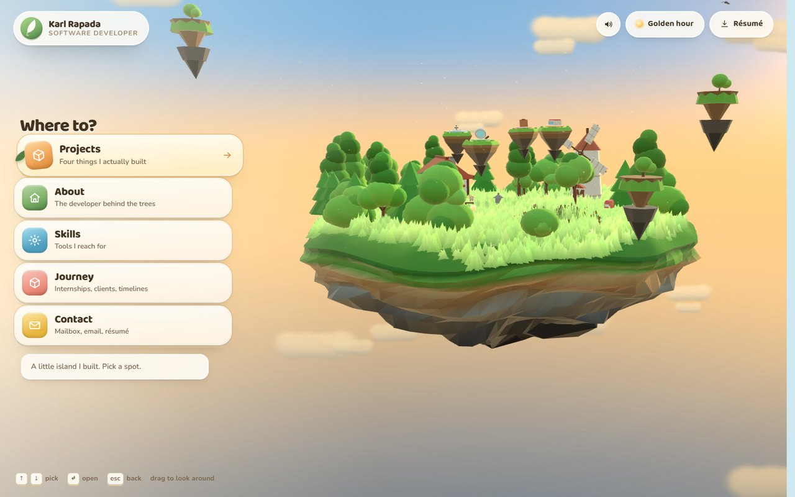
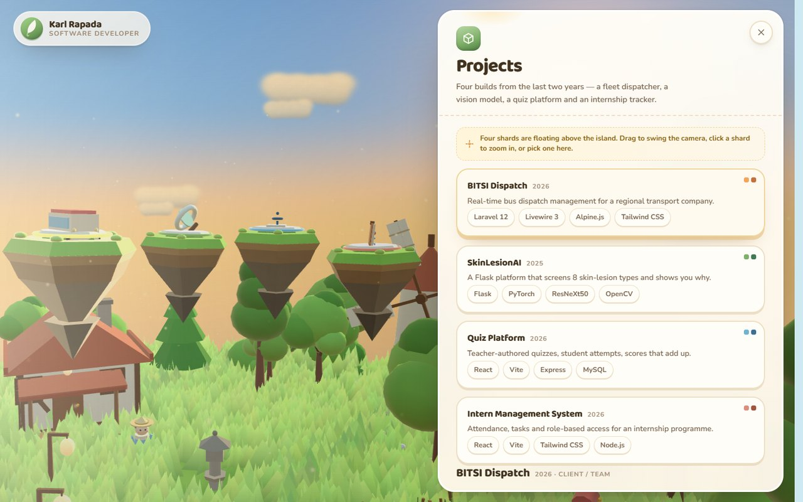
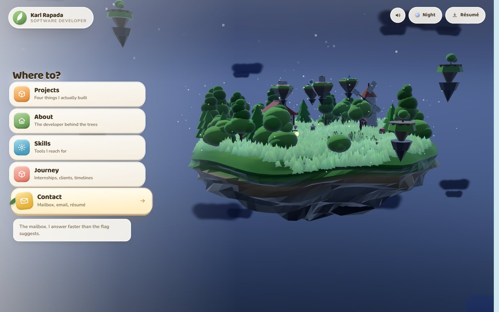

# Portfolio Isle — karlrapada21.github.io

An interactive portfolio that behaves like a video-game menu. The whole
background is one WebGL scene: a floating Ghibli-ish island at golden hour with
a cottage, a windmill, a signpost grove, a pond and four project shards drifting
above the meadow. The menu selects a landmark; the camera leans toward it; a
panel opens over the island.

Live at **https://karlrapada21.github.io**



| Projects | Night |
| --- | --- |
|  |  |

---

## What's in here

```
index.html              markup, import map, boot screen, noscript fallback
css/style.css           all UI styling (Animal-Crossing-ish cards, panels, HUD)
js/main.js              boot, render loop, input wiring, quality ladder
js/world.js             scene assembly + the camera shot for each section
js/data/content.js      every word of copy — edit this, not the UI

js/core/                engine-ish plumbing
  materials.js          the shared cel-shading shader (one program for everything)
  palette.js            day / golden hour / night palettes
  rig.js                damped camera rig + off-axis screen pan
  geo.js                geometry packer -> merged vertex-coloured meshes
  instanced.js          InstancedMesh helper with per-instance tint
  pointer.js            drag / tap / hover with tap-vs-drag slop
  audio.js              synthesised UI blips (no audio files)
  util.js               math, seeded RNG, timing

js/scene/               the island
  island.js             meadow top, stratified cliff, tapered rock underside
  vegetation.js         trees / grass / flowers / stones / shrubs (instanced)
  props.js              cottage, windmill, mailbox, signposts, lanterns, villager
  water.js              pond shader: ripples, fresnel, sun glint, shore foam
  grove.js              the four floating project shards + their emblems
  sky.js                gradient dome, sun disc/bloom, stars, haze
  clouds.js             camera-facing cloud billboards as one draw call per layer
  particles.js          pollen by day, fireflies at night
  birds.js              six distant birds on circular paths
  layout.js             every prop position + scatter keep-outs

js/ui/                  menu.js, panels.js, icons.js

tools/                  headless QA harness (not shipped to Pages)
vendor/                 three.js r170 (minified ES module)
```

## Running it locally

ES modules need a real origin, so `file://` will not work:

```bash
python -m http.server 8099
# then open http://127.0.0.1:8099
```

## How the scene stays cheap

- **One shader program.** Every surface — terrain, trees, cottage, shards —
  uses the same custom cel shader. No lighting rig, no shadow maps, no
  post-processing pass. Colour comes from baked vertex colours, so a 5,000-blade
  grass field is a single `BufferGeometry`.
- **Baked geometry.** `GeoBuilder` merges a prop's parts into one vertex-coloured
  mesh, so the cottage is one draw call and the windmill two.
- **Instancing** for trees, grass, flowers, stones, shrubs, reeds, path stones
  and birds.
- **Wind on the GPU.** Grass and foliage sway in the vertex shader from a shared
  `uTime` uniform — zero per-frame CPU work.
- **One draw call for all clouds.** Camera-facing quads live in a single
  geometry whose positions are computed in the vertex shader.
- **No reflection pass.** The pond fakes it with fresnel plus a specular lobe.
- **Adaptive resolution.** The renderer measures its own frame time and walks
  the pixel ratio between 1.0 and 2.0 to hold the frame budget.
- **Quality ladder.** `pickQuality()` drops instance counts (grass ~5.2k → 1.2k),
  cloud counts and antialiasing on small/touch/save-data clients.
- **Pauses when hidden** and clamps `dt` so a stalled tab cannot launch the
  animation into hyperspace.

Typical desktop numbers: **~55 draw calls, ~100k triangles**, four textures.

## Deploying

This repo *is* the GitHub Pages user site, so push to `main` and Pages serves
the root directory. There is no build step — everything is plain ES modules with
an import map, and `vendor/three.module.min.js` is committed so the site never
depends on a CDN.

`.nojekyll` is present so Pages does not run the files through Jekyll.

## Editing content

All copy lives in `js/data/content.js`:

- `profile` — name, contacts, bio paragraphs (HTML allowed)
- `sections` — the five menu entries: label, one-line description, hover caption,
  panel title and subtitle
- `projects` — one object per shard; `emblem` picks the 3D model (`bus`,
  `scope`, `flag`, `clipboard`), `accent`/`accent2` colour the shard and the UI
- `experience`, `education`, `skillGroups`, `certificates`, `contactLinks`

Camera framing per section lives in `SHOTS` in `js/world.js`; positions of every
prop live in `js/scene/layout.js`.

## Accessibility

- The canvas is `aria-hidden`; every piece of content exists in the DOM.
- The menu is a real `<ul>` of buttons with roving `tabindex`; arrows, Enter,
  Escape and number keys 1–5 work.
- Panels are `role="dialog"` with a Tab trap, and focus returns to the menu item
  that opened them.
- `prefers-reduced-motion` shortens the intro, drops camera parallax and stops
  the island's buoyancy.
- A `<noscript>` block holds the full résumé content as plain HTML, and WebGL
  failure falls back to that same block.

## QA harness

`tools/` contains the headless Chrome probe used while building this. It talks
the DevTools protocol directly over Node's built-in WebSocket, so it has no
dependencies.

```bash
python -m http.server 8099                       # serve the site
node tools/qa.mjs --scenario tools/scenarios/tour.mjs
python tools/analyze.py tools/shots/10-menu-golden.png 72
```

`analyze.py` prints a coarse semantic map of a screenshot plus colour statistics
(a cheap way to check composition without opening the image).

## Credits

Scene and UI built from scratch with [three.js](https://threejs.org) (MIT).
Typefaces: Baloo 2 and Nunito (SIL Open Font License) via Google Fonts.
Everything else — geometry, shaders, textures, sounds — is generated at runtime.
